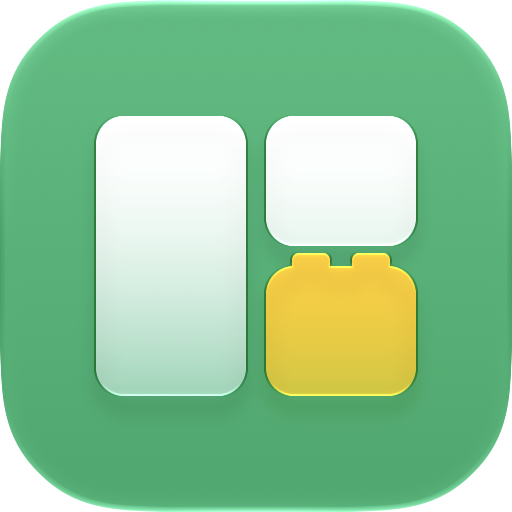

#  winlego

[English](README.md) · **한국어**

**창을 영역에 맞춰 넣고, 그 자리를 지킵니다.**

모니터가 여러 대면 창이 자꾸 흩어집니다. 앱이 제멋대로 예전 자리로 돌아가고,
모니터가 깨어나면 전부 뒤섞이고, 아침마다 창을 끌어다 놓는 데 시간을 씁니다.
winlego 는 디스플레이마다 영역 레이아웃을 정하고, 창을 영역에 넣고, 그 자리를
지켜 주는 작은 macOS 메뉴바 앱입니다.

## 기능

- **디스플레이마다 레이아웃.** 반반, 3열, ⅔ + ⅓, 2×2 격자, 넓은 열 + 옆에 둘 쌓기,
  세로 모니터용 상하, 작은 모니터용 전체 화면. 에디터로 직접 그릴 수도 있습니다.
- **창을 넣는 방법 네 가지.** `⇧` 를 누른 채 끌어서 영역에 놓기. `⌃⌥←` / `⌃⌥→` 로
  영역 순환, `⌃⌥↑` / `⌃⌥↓` 로 디스플레이 이동. 메뉴바에서 영역 고르기. 또는 규칙:
  *터미널은 항상 메인 디스플레이 오른쪽 1/3.*
- **자리를 지킵니다.** 앱이 창을 옮기거나 모니터가 절전에서 깨어나 창이 밀려나면
  되돌립니다. 직접 끌어다 놓으면 배정이 풀립니다. winlego 는 사용자와 싸우지 않습니다.
- **실제 화면에서 영역 크기 조절.** 배정된 창 두 개가 맞닿은 경계를 끌면 양쪽 창이
  실시간으로 따라옵니다. 놓으면 새 비율을 그 디스플레이의 레이아웃으로 저장할지 묻습니다.
- **권한 하나, 네트워크 없음.** 손쉬운 사용 권한만 씁니다. 수집하는 것 없음.

## 설치

아직 비공개 개발 중입니다. 소스에서 빌드합니다(Swift 6 툴체인, Xcode 불필요):

```sh
scripts/bundle.sh && open build/winlego.app
```

로컬 인증서로 서명했고 공증은 하지 않아 첫 실행 때 macOS 가 열기를 거부할 수
있습니다. `xattr -dr com.apple.quarantine build/winlego.app` 을 한 번 실행하세요.
공개 후에는 Homebrew cask 를 제공할 예정입니다.

## 빠른 시작

1. winlego 를 열고 시스템 설정 › 개인정보 보호 및 보안 › **손쉬운 사용**(macOS 27 에서는
   **기기 제어 및 데이터 접근**)에서 허용합니다.
2. 메뉴바의 격자 아이콘 › **Layouts** 에서 디스플레이마다 레이아웃을 고릅니다.
3. `⇧` 를 누른 채 창을 끌어 영역에 놓습니다. 또는 `⌃⌥→`.
4. 마음에 들면 **Remember This Window Here**. 이제 그 앱의 창은 늘 거기서 열립니다.

메뉴 항목, 규칙, 레이아웃 에디터, 문제 해결은 **[매뉴얼](docs/manual.ko.md)** 에
있습니다 ([English](docs/manual.md)).

## 단축키

| 키 | 동작 |
|---|---|
| `⌃⌥←` / `⌃⌥→` | 이 디스플레이의 이전 / 다음 영역 |
| `⌃⌥↑` / `⌃⌥↓` | 이전 / 다음 디스플레이의 같은 영역 |
| `⌃⌥↩` | 모든 창을 규칙대로 정렬 |
| `⌃⌥⌫` | 현재 창을 영역에서 해제 |
| `⇧` + 드래그 | 영역 표시, 놓아서 배정 |

## 동작 원리

winlego 는 macOS 손쉬운 사용(Accessibility) API 로 다른 앱의 창을 읽고 옮깁니다.
Rectangle, Amethyst, Magnet 이 쓰는 것과 같은 공개 API 이며, 앱마다 창이 열리고
움직이고 크기가 바뀌는 것을 감시합니다. 레이아웃은 분할 트리라서 두 영역 사이의
경계는 분할 하나의 비율입니다. 경계를 끌면 그 비율이 바뀌고 영향 받는 영역의 창이
전부 따라옵니다. 순수 로직(레이아웃, 영역 기하, 규칙, 유지 정책)은 `WinlegoCore` 에
단위 테스트와 함께 있고, 앱 타깃은 그 위의 AppKit·SwiftUI 껍데기입니다.

맥 앱스토어는 샌드박스를 요구하고 샌드박스 앱은 손쉬운 사용 API 를 쓸 수 없기
때문에, 2012년 이후 나온 다른 창 관리 앱들처럼 winlego 도 직접 배포합니다.

## 개발

```sh
scripts/test.sh                      # 단위 테스트 (WinlegoCore)
swift build                          # 디버그 빌드
ARCHS=arm64 scripts/bundle.sh        # build/winlego.app, 서명 포함
scripts/release.sh 0.1.0             # dist/winlego-0.1.0.zip
```

로그: `/usr/bin/log show --last 5m --info --predicate 'subsystem == "io.github.esteban-eg-kim.winlego"'`.

## 라이선스

MIT. [LICENSE](LICENSE) 참고.
