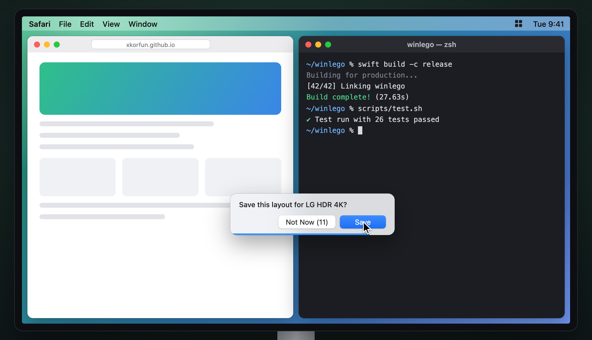

#  winlego

**English** · [한국어](README.ko.md) · [Website](https://xkorfun.github.io)

**Snap windows into zones, and keep them there.**

With more than one display, windows drift: an app restores itself to the wrong
place, a monitor wakes up and everything shuffles, and you spend the morning
dragging things back. winlego is a small macOS menu bar app that gives each
display a zone layout, puts windows into zones, and keeps them there.

<p align="center">
  
</p>

<p align="center"><a href="docs/media/demo-en.mp4">Watch in full quality (MP4)</a></p>

## Features

- **A layout per display.** Halves, thirds, ⅔ + ⅓, a 2×2 grid, a stack beside a
  wide column, top and bottom for a portrait monitor, or the whole screen for a
  small one. Or draw your own in the editor.
- **Four ways to place a window.** Hold `⇧` while dragging and drop it on a zone;
  add `⌃` once the drag is under way to merge the zones you pass over into one. Press `⌃⌥←` / `⌃⌥→` to step
  through zones, `⌃⌥↑` / `⌃⌥↓` to hop displays (shortcuts are yours to change).
  Pick a zone from the menu bar. Or set a rule: *Terminal always goes to the
  right third of the main display.*
- **It stays put.** If an app moves its window, or a display sleeps and wakes,
  winlego puts the window back. Drag a window away yourself and it is released;
  winlego never fights you.
- **Resize zones on the real screen.** When two placed windows share a boundary,
  drag that boundary. Both windows follow live. On release, choose whether to keep
  the new proportions as the display's layout.
- **One permission, no network.** Accessibility only. Nothing is collected.
- **English and Korean.** Follows the system language.

## Install

```sh
brew install --cask esteban-eg-kim/tap/winlego
```

Or download `winlego-x.y.z.zip` from [Releases](https://github.com/esteban-eg-kim/winlego/releases),
move `winlego.app` to `/Applications`, and run once:

```sh
xattr -dr com.apple.quarantine /Applications/winlego.app
```

winlego is signed but not notarized (no paid Apple Developer account), so without
that line macOS refuses to open it. Homebrew does it for you. Requires macOS 13
or later, Apple silicon or Intel.

## Quick start

1. Open winlego and allow it under System Settings › Privacy & Security ›
   **Accessibility** (on macOS 27: **Device Control and Data Access**).
2. Click the grid in the menu bar › **Layouts** and pick a layout for each display.
3. Hold `⇧`, drag a window, and drop it on a zone. Or press `⌃⌥→`.
4. Like where it is? Choose **Remember This Window Here**. From now on that app's
   windows open there.

The full guide covers every menu item, rules, the layout editor and
troubleshooting: **[Manual](docs/manual.md)** ([한국어](docs/manual.ko.md)).

<p align="center"></p>

<p align="center"></p>

## Shortcuts

| Keys | Action |
|---|---|
| `⌃⌥←` / `⌃⌥→` | Previous / next zone on this display |
| `⌃⌥↑` / `⌃⌥↓` | Same zone on the previous / next display |
| `⌃⌥↩` | Arrange every window by its rule |
| `⌃⌥⌫` | Release the focused window from its zone |
| `⇧` + drag | Show zones; drop to place |
| `⇧` + drag, then `⌃` | Merge the zones you pass over; drop to fill them all |

Change any shortcut in Settings › General.

## How it works

winlego reads and moves other apps' windows through the macOS Accessibility API,
the same public API that Rectangle, Amethyst and Magnet use, and watches each app
for windows that open, move or resize. Layouts are trees of splits, so the
boundary between two zones is one split's ratio; dragging a boundary changes that
ratio and every window in the affected zones follows. Pure logic (layouts, zone
geometry, rules, the enforcement policy) lives in `WinlegoCore` with unit tests;
the app target is the AppKit and SwiftUI shell around it.

Because the Mac App Store requires sandboxing and sandboxed apps cannot use the
Accessibility API, winlego is distributed directly, like every window manager
released after 2012.

## Development

```sh
scripts/test.sh                      # unit tests (WinlegoCore)
swift build                          # debug build
ARCHS=arm64 scripts/bundle.sh        # build/winlego.app, signed
scripts/release.sh 0.2.1             # dist/winlego-0.2.1.zip
docs/media/make.sh                   # screenshots and demo (Chrome, Node 22)
scripts/make-icon.sh                 # app icon from Resources/AppIcon.icon (Xcode)
```

Logs: `/usr/bin/log show --last 5m --info --predicate 'subsystem == "io.github.esteban-eg-kim.winlego"'`.

## License

MIT. See [LICENSE](LICENSE).
